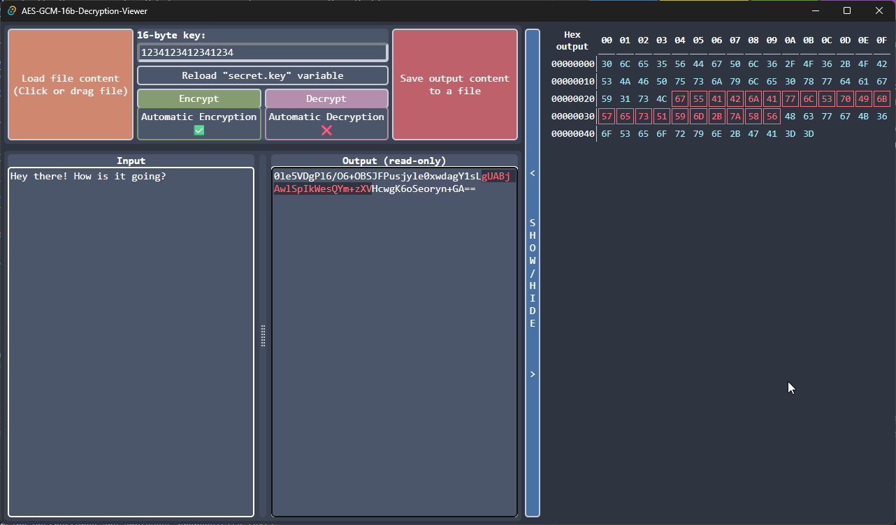

# AES-GCM-16b-Decryption-Viewer

[](https://opensource.org/licenses/MIT)


A secure, cross-platform desktop application built with Rust and Tauri for encrypting and decrypting text and files using the AES-GCM-128 standard.



## Table of Contents

- [AES-GCM-16b-Decryption-Viewer](#aes-gcm-16b-decryption-viewer)
  - [Table of Contents](#table-of-contents)
  - [About The Project](#about-the-project)
  - [Key Features](#key-features)
  - [Tech Stack](#tech-stack)
  - [Architecture](#architecture)
  - [Getting Started](#getting-started)
    - [Prerequisites](#prerequisites)
    - [Installation](#installation)
  - [Usage](#usage)
  - [Technical Challenges \& Lessons Learned](#technical-challenges--lessons-learned)
  - [Future Improvements](#future-improvements)
  - [License](#license)

## About The Project

This project is a high-performance desktop utility for AES-GCM encryption and decryption. In an era where data privacy is paramount, there is a need for simple, secure, and offline tools to handle sensitive information. This application provides a user-friendly interface to perform strong, authenticated encryption without relying on third-party web services.

Built with Rust for its performance and memory safety, and Tauri for its lightweight, cross-platform GUI capabilities, the AES-GCM-16b-Decryption-Viewer is both powerful and secure. It serves as a practical tool for developers, security enthusiasts, or anyone needing to quickly encrypt or decrypt data using a robust, industry-standard algorithm.

## Key Features

-   **Strong Encryption:** Implements AES-GCM with a 128-bit key (16 bytes), providing both confidentiality and data integrity.
-   **File I/O:** Seamlessly load data from text files and save encrypted or decrypted output back to a file.
-   **Interactive Hex Viewer:** An integrated, performant hex viewer displays the raw byte representation of the output, complete with text selection that mirrors the hex data.
-   **Automatic Mode:** Optional "Automatic Encryption/Decryption" modes that process data in real-time as you type.
-   **Cross-Platform:** Packaged for Windows, macOS, and Linux, thanks to the Tauri framework and an automated GitHub Actions CI/CD pipeline.

## Tech Stack

The project leverages a modern, performance-oriented technology stack:

-   **Backend & Core Logic:** [Rust](https://www.rust-lang.org/)
-   **Desktop Framework:** [Tauri](https://tauri.app/)
-   **Frontend:** HTML5, CSS3, Vanilla JavaScript
-   **Cryptography:** [aes-gcm](https://crates.io/crates/aes-gcm) (Rust Crate)
-   **CI/CD & Build Automation:** [GitHub Actions](https://github.com/features/actions)

## Architecture

The application follows the standard Tauri architectural pattern, which combines a powerful Rust backend with a webview-based frontend.

-   **Rust Backend:** Manages all core logic, including the cryptographic operations using the `aes-gcm` crate, file system interactions, and environment variable access. Rust functions are exposed securely to the frontend as `#[tauri::command]`.
-   **Webview Frontend:** The UI is built with standard web technologies (HTML, CSS, JS), running in a system webview. This keeps the application lightweight and responsive.
-   **Frontend-Backend Communication:** JavaScript communicates with the Rust backend via Tauri's asynchronous `invoke` API. This provides a secure and efficient bridge, allowing the UI to call Rust functions and receive results without blocking the user interface.

## Getting Started

To get a local copy up and running, follow these simple steps.

### Prerequisites

You must have the Rust toolchain and Tauri CLI installed on your system.
1.  **Install Rust:** Follow the official instructions at [rust-lang.org](https://www.rust-lang.org/tools/install).
2.  **Install Tauri CLI:**
    ```sh
    cargo install tauri-cli
    ```

### Installation

1.  **Clone the repository:**
    ```sh
    git clone https://github.com/Sohaib-K/AES-GCM-16b-Decryption-Viewer.git
    ```
2.  **Navigate to the project directory:**
    ```sh
    cd AES-GCM-16b-Decryption-Viewer
    ```
3.  **Run the application in development mode:**
    ```sh
    cargo tauri dev
    ```

## Usage

1.  Launch the application.
2.  Enter a **16-byte (128-bit) key** into the key input field.
3.  Paste or type the text you wish to process into the **Input** text area.
4.  Click **Encrypt** or **Decrypt**.
5.  The result will appear in the **Output** text area and the Hex Viewer.
6.  Use the **Load file content** and **Save output content** buttons for file operations.

## Technical Challenges & Lessons Learned

This project provided opportunities to solve interesting technical problems, demonstrating skills in both backend and frontend development.

1.  **Challenge: Building a Performant Hex Viewer for Large Data**
    -   **Problem:** Displaying the hexadecimal representation of large outputs could freeze the UI if every byte was rendered as a DOM element simultaneously. This would lead to poor performance and high memory consumption.
    -   **Solution:** I implemented a **virtual scrolling** mechanism in JavaScript for the hex viewer. This technique only renders the rows that are currently visible in the viewport (plus a small buffer). As the user scrolls, DOM elements that move out of view are removed, and new ones are added, ensuring the UI remains smooth and responsive regardless of the output size.
    -   **What I Learned:** This challenge deepened my understanding of frontend performance optimization, DOM manipulation, and UI virtualization patterns. It's a practical skill directly applicable to building scalable user interfaces.

2.  **Challenge: Secure and Efficient Rust-JavaScript Interoperability**
    -   **Problem:** The core cryptographic logic resides in Rust for performance and security, while the UI is in JavaScript. A bridge was needed to communicate between them without introducing security risks or performance bottlenecks.
    -   **Solution:** I leveraged Tauri's `command` system. By decorating Rust functions with `#[tauri::command]`, they are exposed to the frontend and can be called asynchronously using Tauri's `invoke` API. This provides a type-safe, performant, and secure channel for all frontend-backend communication.
    -   **What I Learned:** This project provided hands-on experience with the hybrid application model and the foreign function interface (FFI) paradigm that Tauri abstracts away. It solidified my ability to architect applications that combine the strengths of different languages.

3.  **Challenge: Automating Cross-Platform Builds**
    -   **Problem:** Manually building, packaging, and distributing a desktop application for Windows, macOS, and Linux is a tedious and error-prone process.
    -   **Solution:** I configured a **CI/CD pipeline using GitHub Actions** and the official `tauri-action`. This workflow automatically triggers on new version tags, building native installers (`.msi`, `.dmg`, `.deb`, `.AppImage`) for all three major platforms and attaching them to a draft GitHub Release.
    -   **What I Learned:** This demonstrates practical DevOps skills and proficiency with modern CI/CD practices. Automating the build and release process is a critical skill for professional software development.

## Future Improvements

-   **Add Unit & Integration Tests:** Implement a robust testing suite for the Rust backend to ensure the reliability and correctness of the cryptographic functions.
-   **Support Additional Algorithms:** Extend the application to support other ciphers (e.g., AES-256, ChaCha20-Poly1305) and hashing algorithms.
-   **Refactor Frontend:** Migrate the vanilla JavaScript to a modern framework like Svelte or Vue for improved state management and component organization.
-   **Enhance Key Management:** Implement features for generating secure random keys and loading/saving keys from protected files.

## License

Distributed under the MIT License. See `LICENSE` for more information.
