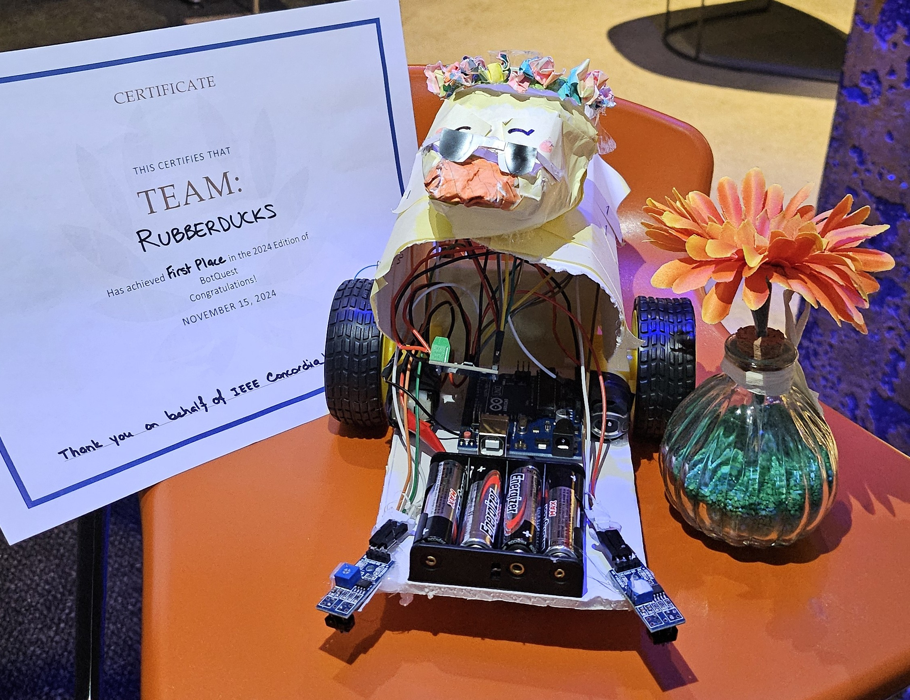

# BotQuest: The Line-Following Duck

[](https://ieee.concordia.ca/warhacks/)
[](https://www.arduino.cc/)
[](https://isocpp.org/)

A 1st place winning, line-following robot built with an Arduino and just two IR sensors for the BotQuest (Warhacks) hackathon.

---



## 📖 Table of Contents

-   [About The Project](#about-the-project)
-   [Key Features](#-key-features)
-   [Tech Stack](#-tech-stack)
-   [System Design & Logic](#-system-design--logic)
-   [Getting Started](#-getting-started)
-   [Technical Challenges & Lessons Learned](#-technical-challenges--lessons-learned)
-   [Future Improvements](#-future-improvements)
-   [License](#-license)
-   [Contact](#-contact)

## 🎯 About The Project

This project is the **1st Place winning entry** for **BotQuest (Warhacks)**, a hardware hackathon organized by IEEE Concordia. The challenge was to design, build, and program a line-following robot capable of navigating a complex maze using a minimal set of provided equipment.

The entire robot was constructed from the ground up within the hackathon's time limit using just one Arduino Uno, two infrared (IR) reflective sensors, two DC motors, and a battery pack. The core of the project is a robust control algorithm that can interpret the limited sensor data to make precise navigation decisions. To add a memorable and creative touch, the chassis was decorated as a rubber duck using post-it notes, which was a highlight for the judges.

This project demonstrates resourcefulness, rapid prototyping, and effective problem-solving under tight constraints.

## ✨ Key Features

-   **Robust Line-Following Logic:** Developed a state-based algorithm that uses input from only two IR sensors to navigate sharp turns, straight lines, and complex track sections.
-   **Efficient Hardware Implementation:** Engineered to perform its core function reliably using a minimal bill of materials, demonstrating resourcefulness and a focus on core functionality.
-   **1st Place Winning Execution:** The combination of a reliable algorithm, clean build, and creative presentation secured the top prize in a competitive hackathon environment.
-   **Real-time Control System:** The Arduino C++ code processes sensor data and adjusts motor speeds in real-time to stay on the line.

## 🛠️ Tech Stack

-   **Microcontroller:** Arduino Uno
-   **Programming Language:** C++ (Arduino Framework)
-   **Sensors:** 2x Infrared (IR) Reflective Sensors
-   **Actuators:** 2x DC Motors with a Motor Driver

## ⚙️ System Design & Logic

The robot's operation is based on a simple yet effective feedback loop: **Sense -> Decide -> Act**.

<!-- 
💡 A simple diagram can be very effective here. 
You can create one easily with tools like draw.io or Excalidraw. 
-->
**[INSERT SIMPLE ARCHITECTURE/LOGIC FLOW DIAGRAM HERE]**

1.  **Sensor Input:** Two IR sensors are placed on either side of the line. Each sensor emits infrared light and measures the reflection. A black line absorbs light (LOW reading), while a white surface reflects it (HIGH reading).

2.  **Control Logic (The Algorithm):** The Arduino runs a simple finite state machine based on the sensor readings:
    *   **Both Sensors see White (On Line):** The robot is centered on the line. **Action:** Move both motors forward at equal speed.
    *   **Left Sensor sees Black, Right sees White:** The robot is drifting to its left. **Action:** Slow down or reverse the left motor and speed up the right motor to turn right, re-centering on the line.
    *   **Right Sensor sees Black, Left sees White:** The robot is drifting to its right. **Action:** Slow down or reverse the right motor and speed up the left motor to turn left.

3.  **Motor Output:** Based on the decision from the control logic, the Arduino sends Pulse Width Modulation (PWM) signals to a motor driver, which precisely controls the speed and direction of each of the two motors.

## 🚀 Getting Started

To replicate this project, you will need the specified hardware and the Arduino IDE.

### Hardware Prerequisites

-   1x Arduino Uno
-   2x DC Motors
-   1x L298N Motor Driver (or similar)
-   2x IR Reflective Sensors (like TCRT5000)
-   1x Small Robot Chassis
-   1x 9V Battery or Power Bank

### Software Prerequisites

-   [Arduino IDE](https://www.arduino.cc/en/software)

### Installation & Setup

1.  **Clone the Repository:**
    ```sh
    git clone https://github.com/kaidalisohaib/your-repo-name.git
    ```
2.  **Assemble the Hardware:**
    Wire the motors, sensors, and motor driver to the Arduino according to the schematic.
    <!-- 
    💡 A Fritzing diagram or a clear photo of your wiring would be perfect here. 
    -->
    **[INSERT WIRING DIAGRAM/FRITZING SCHEMATIC HERE]**

3.  **Upload the Code:**
    -   Open the `.ino` file in the Arduino IDE.
    -   Connect your Arduino to your computer via USB.
    -   Select the correct Board (Arduino Uno) and Port from the `Tools` menu.
    -   Click the "Upload" button.

4.  **Calibrate & Run:**
    Place the robot on its track and power it on. You may need to adjust the sensitivity of the IR sensors or the motor speed values in the code for optimal performance.

## 🧠 Technical Challenges & Lessons Learned

#### 1. Navigating Sharp Turns with Only Two Sensors

-   **The Problem:** Most line-following robots use 3-5 sensors to get more granular data. With only two sensors, it's difficult to distinguish between a sharp 90-degree turn and simply losing the line. If both sensors see white, the robot doesn't know whether to turn hard left, hard right, or stop.
-   **The Solution:** I implemented a "last known direction" state variable. When the robot lost the line (both sensors on white), it would reference its last turn direction. For example, if it was last correcting to the right, it would initiate a sharp right pivot to "find" the line again. This simple memory mechanism made the navigation far more robust without needing extra hardware.
-   **What I Learned:** This project was a masterclass in **control logic under hardware constraints**. It taught me to maximize the utility of minimal data and the power of state management in embedded systems.

#### 2. Fine-Tuning Motor Control and Sensor Thresholds

-   **The Problem:** The IR sensors were sensitive to ambient light, and the two DC motors were not perfectly matched, causing the robot to drift even when given identical commands.
-   **The Solution:** I wrote a simple calibration routine at the start of the code to read ambient light and set a dynamic threshold for what counts as "black" vs. "white". For the motors, instead of using a single speed, I fine-tuned the PWM values for each motor individually through iterative testing, creating a slight offset that corrected the natural drift.
-   **What I Learned:** This experience provided deep, practical insight into the gap between digital code and real-world analog/mechanical behavior. It solidified my understanding of **PWM for speed control** and the importance of **calibration in robotics**.

## 📈 Future Improvements

-   **Implement a PID Controller:** Upgrade the simple on/off control logic to a Proportional-Integral-Derivative (PID) controller for smoother, faster, and more accurate line following.
-   **Add More Sensors:** Incorporate a 5-sensor array to handle intersections, forks in the track, and even more complex navigation challenges.
-   **Obstacle Avoidance:** Integrate an ultrasonic sensor to detect and navigate around obstacles placed on the track, adding another layer of autonomy.

## 📜 License

Distributed under the MIT License. See `LICENSE` for more information.
