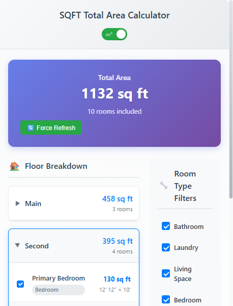

# SQFT Area Calculator

[](https://github.com/your-username/your-repo-name/actions)
[](https://opensource.org/licenses/MIT)
[](https://developer.mozilla.org/en-US/docs/Web/JavaScript)
[](https://jestjs.io/)

A cross-browser extension that automatically extracts room dimensions from Canadian real estate listings (realtor.ca, housesigma.com) to calculate total usable square footage.

---

## Visual Demo



_A quick demonstration of the extension calculating the total area from a property listing._

## Table of Contents

- [SQFT Area Calculator](#sqft-area-calculator)
  - [Visual Demo](#visual-demo)
  - [Table of Contents](#table-of-contents)
  - [About The Project](#about-the-project)
  - [Key Features](#key-features)
  - [Tech Stack](#tech-stack)
  - [Getting Started](#getting-started)
    - [Prerequisites](#prerequisites)
    - [Installation](#installation)
  - [Usage](#usage)
  - [Technical Challenges \& Lessons Learned](#technical-challenges--lessons-learned)
    - [1. Parsing Inconsistent and Dynamic DOMs](#1-parsing-inconsistent-and-dynamic-doms)
    - [2. Ensuring Cross-Browser Compatibility](#2-ensuring-cross-browser-compatibility)
  - [Future Improvements](#future-improvements)
  - [License](#license)

## About The Project

When browsing for properties online, one of the most tedious tasks is manually calculating the total usable square footage. Listings often provide dimensions room by room, sometimes in different units (imperial vs. metric), making direct comparisons difficult.

The **SQFT Area Calculator** solves this problem by automating the entire process. This browser extension intelligently parses property listing pages on major Canadian real estate sites, extracts all room dimensions, converts them to a consistent unit, and presents a comprehensive, filterable breakdown of the total area. It's a practical tool designed to save time and provide clearer insights for potential homebuyers.

## Key Features

- **🤖 Automatic Data Extraction:** Intelligently parses room data from **realtor.ca** and **housesigma.com**, including dynamically loaded popups on map views.
- **📊 Real-Time Calculation:** Instantly calculates the total area as soon as the extension is opened on a supported page.
- ** interactive Floor Breakdown:** View a detailed, expandable list of all rooms grouped by floor level.
- **⚙️ Customizable Filtering:**
  - Exclude entire room categories (e.g., bathrooms, laundry) from the total.
  - Fine-tune calculations by toggling individual rooms on or off.
- **🔄 Unit Conversion:** Seamlessly switch the display between Imperial (sq ft) and Metric (m²) units.
- **🌐 Cross-Browser Support:** Fully functional on both Google Chrome (Manifest V3) and Mozilla Firefox.

## Tech Stack

This project was built with a focus on modern, dependency-free JavaScript and robust development practices.

- **Core:** Vanilla JavaScript (ES6+), HTML5, CSS3
- **Environment:** Browser Extension APIs (Manifest V3 for Chrome, V2 for Firefox)
- **Testing:** Jest for unit, integration, and parser testing.
- **DevOps & Tooling:**
  - GitHub Actions for Continuous Integration (CI)
  - Node.js for custom build scripts
  - Prettier & ESLint for code quality and consistency

## Getting Started

To get a local copy up and running, follow these simple steps.

### Prerequisites

- A modern web browser like Google Chrome or Mozilla Firefox.
- Node.js (v16 or higher) and pnpm package manager.
  ```sh
  npm install -g pnpm
  ```

### Installation

1.  **Clone the repository**
2.  **Install dependencies:**
    ```sh
    pnpm install
    ```
3.  **Build the extension files:**

    ```sh
    pnpm run build
    ```

    This will create optimized `dist/chrome` and `dist/firefox` directories.

4.  **Load the extension in your browser:**
    - **For Chrome:**
      1.  Go to `chrome://extensions/`.
      2.  Enable "Developer mode".
      3.  Click "Load unpacked".
      4.  Select the `dist/chrome` folder.
    - **For Firefox:**
      1.  Go to `about:debugging#/runtime/this-firefox`.
      2.  Click "Load Temporary Add-on...".
      3.  Select any file inside the `dist/firefox` folder (e.g., `manifest.json`).

## Usage

1.  Navigate to a property listing on a supported website:
    - [realtor.ca](https://www.realtor.ca/)
    - [housesigma.com](https://housesigma.com/)
2.  If you are on a HouseSigma map, click on a property pin to open its details popup.
3.  Click the extension icon in your browser's toolbar.
4.  The popup will appear, displaying the total calculated area and a detailed breakdown.
5.  Use the filters and toggles to customize the calculation to your needs.

## Technical Challenges & Lessons Learned

This project presented several interesting technical challenges that were crucial for its success.

### 1. Parsing Inconsistent and Dynamic DOMs

- **The Problem:** `realtor.ca` and `housesigma.com` have vastly different HTML structures and data formats (imperial vs. metric). Furthermore, HouseSigma's map view dynamically loads property details into a popup, which is not present on the initial page load.
- **The Solution:** I designed a modular parser system where a main content script detects the active website and injects the appropriate specialized parser. For the dynamic content on HouseSigma, I implemented a `MutationObserver` to watch for DOM changes. This allows the extension to reliably detect when the property popup appears and only then trigger the data extraction, ensuring it works seamlessly on both static pages and interactive maps.
- **What I Learned:** This project was a deep dive into robust DOM manipulation and defensive programming. I learned to write code that is resilient to minor website updates and mastered advanced browser APIs like `MutationObserver` to handle modern, asynchronous web applications effectively.

### 2. Ensuring Cross-Browser Compatibility

- **The Problem:** Google Chrome is enforcing Manifest V3, which uses a Service Worker for background tasks, while Firefox has stronger support for the traditional Manifest V2 with background scripts. Their extension APIs (`chrome.*` vs. `browser.*`) and promise handling also differ.
- **The Solution:** I created two separate manifest files and used Node.js build scripts to generate tailored extension packages for each browser from a single codebase. I wrote a lightweight compatibility layer (`utils/browser_features.js`) that abstracts away the API differences, allowing the core logic to be platform-agnostic. The entire process is automated in the CI/CD pipeline, which builds and validates both versions on every commit.
- **What I Learned:** I gained significant experience in browser extension architecture, understanding the trade-offs between MV2 and MV3, and the importance of polyfills and feature detection. This approach resulted in a highly maintainable and scalable cross-browser solution.

## Future Improvements

- [ ] **Expand Website Support:** Add parsers for other popular real estate platforms like Zolo.ca.
- [ ] **Data Persistence:** Implement a feature to save or export the calculated area data for comparison.
- [ ] **Migrate to TypeScript:** Refactor the codebase to use TypeScript for improved type safety and long-term maintainability.
- [ ] **Add Containerization:** Introduce a Docker environment to streamline local development setup.

## License

Distributed under the MIT License. See `LICENSE` for more information.